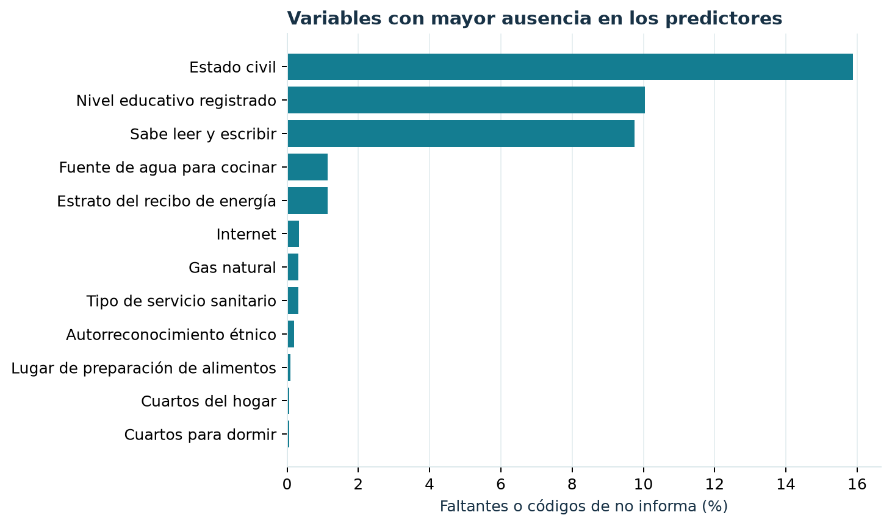

# Calidad de los datos {#calidad}

## Comprobaciones antes de analizar

Se verificaron tres puntos que cambian el significado de cualquier resultado: la regla de la etiqueta, la unicidad de las claves y el enlace entre tablas. La regla deja `r entero(resumen$sin_etiqueta)` respuestas sin clasificación entre las `r entero(resumen$problema_salud)` personas que declararon el problema de salud. Las `r entero(resumen$cohorte)` personas restantes tienen clave única y todas encontraron un hogar y una vivienda con las claves exigidas.

Esto resuelve un riesgo frecuente al combinar archivos censales: una unión de muchos a muchos podría inflar recuentos y alterar tasas sin generar un error visible. En este caso se exigió explícitamente una unión de muchos individuos hacia un único hogar y una única vivienda.

## Faltantes y códigos de no respuesta

La figura \@ref(fig:fig-faltantes) muestra las doce variables de entrada con mayor proporción de ausencia después de sumar faltantes literales y códigos especiales de «no informa» o «no aplica» reconocidos por el pipeline.

```{r fig-faltantes, fig.cap="Ausencia observada en las variables del modelo. Porcentaje sobre 136.034 personas de la cohorte; combina valores vacíos y códigos centinela definidos en el esquema."}

```

```{r tabla-faltantes}
falt <- leer("calidad_variables.csv")
principal <- falt[seq_len(min(10, nrow(falt))), c("feature", "descripcion", "raw_missing", "missing_or_sentinel", "pct")]
principal$raw_missing <- vapply(principal$raw_missing, entero, character(1))
principal$missing_or_sentinel <- vapply(principal$missing_or_sentinel, entero, character(1))
principal$pct <- vapply(principal$pct, porcentaje, character(1))
knitr::kable(principal, col.names = c("Variable", "Contenido", "Vacíos literales", "Vacíos + códigos", "Porcentaje"),
             caption = "Variables con mayor ausencia en la cohorte analítica.")
```

El estado civil tiene `r porcentaje(falt$pct[falt$feature == "P_EST_CIVIL"])` de ausencia; educación, `r porcentaje(falt$pct[falt$feature == "P_NIVEL_ANOSR"])`; y alfabetismo, `r porcentaje(falt$pct[falt$feature == "P_ALFABETA"])`. Parte de los vacíos literales en estas preguntas coincide con edades para las que el cuestionario no aplica. Por eso sería incorrecto tratarlos automáticamente como pérdida aleatoria o rellenarlos con una categoría sustantiva inventada. El modelo conserva la ausencia como señal categórica o la imputa, según el tipo de variable, **dentro** de cada partición de entrenamiento.

En vivienda y hogar, la fuente de agua para cocinar y el estrato del recibo de energía se sitúan alrededor de 1,1 % de ausencia combinada. Una ausencia pequeña tampoco garantiza ausencia de sesgo: puede concentrarse en situaciones específicas. El perfil completo de 26 campos se conserva en `data/calidad_variables.csv` **dentro de las fuentes del Bookdown** y se deriva del mismo universo que el experimento.

## Controles que siguen siendo necesarios

La consistencia de claves y la baja ausencia de muchos campos no prueban que las respuestas sean exactas. El CNPV recoge declaraciones; pueden existir errores de recuerdo, interpretación o registro que estos archivos no permiten verificar. La variable objetivo simplifica una experiencia de atención más amplia a una sola opción principal. Por ello, la discusión de resultados se limita a asociaciones observadas y a una etiqueta operativa.
