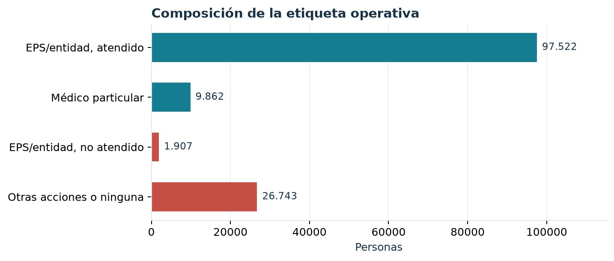
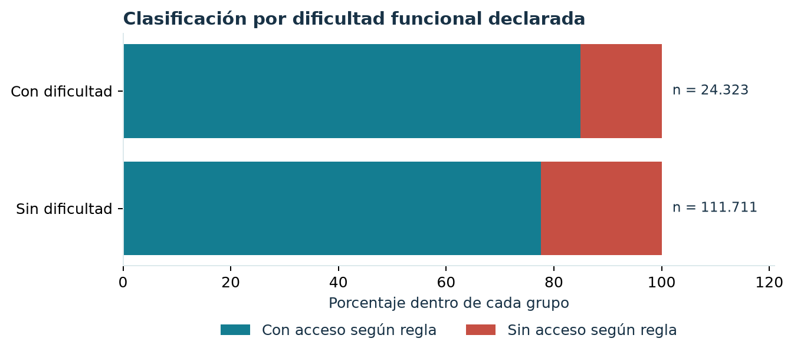
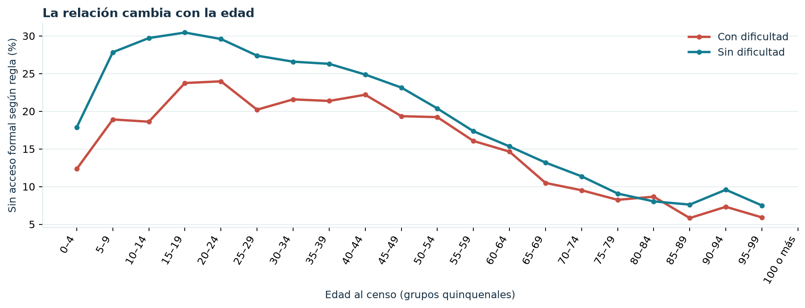
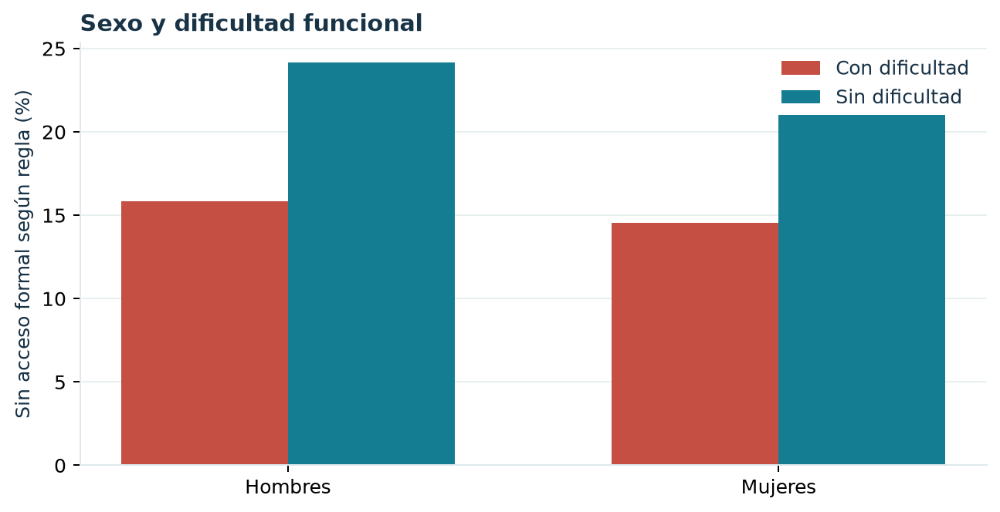
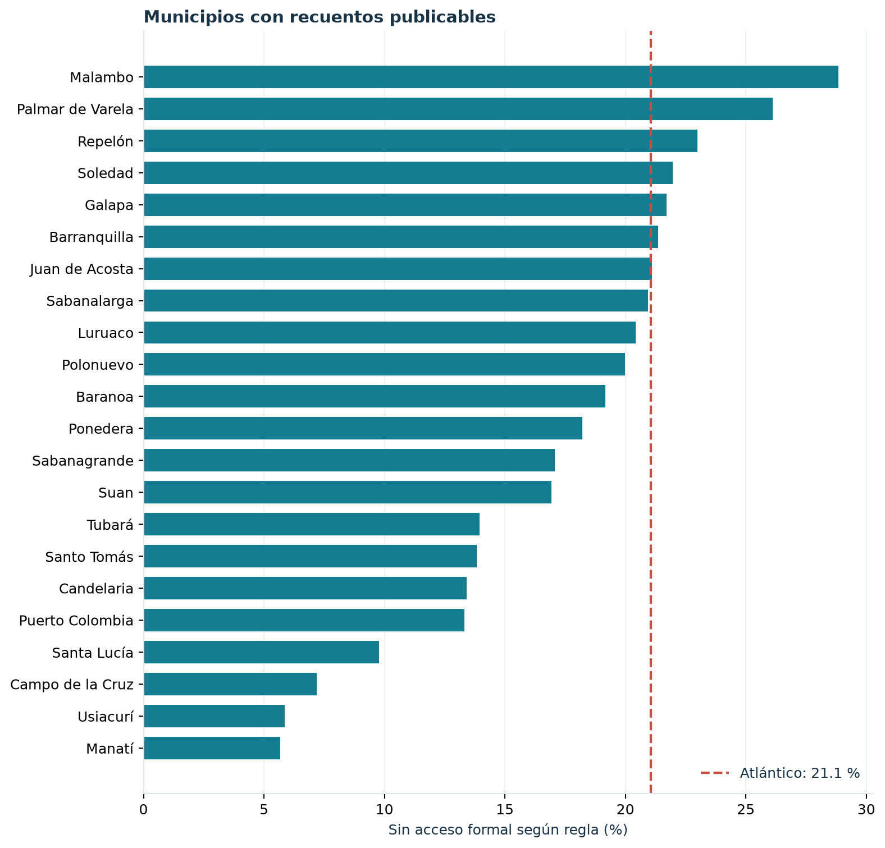

# Exploración descriptiva {#exploracion}

Todas las figuras de este capítulo utilizan el mismo denominador inicial: las `r entero(resumen$cohorte)` personas con problema de salud reciente sin hospitalización y etiqueta clasificable. Dentro de cada grupo, la tasa se calcula como personas en la clase operativa `SIN_ACCESO = 1` divididas entre las personas de ese grupo. Son porcentajes **descriptivos y sin ajuste**; una diferencia visible no prueba que el grupo cause el resultado.

## De qué está hecha la clasificación

```{r fig-composicion, fig.cap="Distribución por tratamiento principal declarado. Azul: con acceso según la regla; rojo: sin acceso según la regla. La categoría de otras acciones o ninguna no implica que jamás se haya recibido atención formal."}

```

La gran mayoría de personas clasificadas con acceso proviene de la combinación «EPS o entidad, atendido» (`r entero(comp$n[comp$tratamiento_principal == "EPS/entidad, atendido"])`). En el grupo clasificado sin acceso predominan las otras acciones o ninguna (`r entero(comp$n[comp$tratamiento_principal == "Otras acciones o ninguna"])`), frente a los `r entero(comp$n[comp$tratamiento_principal == "EPS/entidad, no atendido"])` que dijeron haber acudido a su entidad sin atención. Esta composición debe acompañar cualquier titular del resultado: la cifra de `r porcentaje(resumen$porcentaje_sin_formal)` **no es una tasa de rechazo de servicios**.

## Dificultad funcional

```{r fig-dificultad, fig.cap="Distribución de la clasificación dentro de cada categoría de dificultad funcional diaria declarada. Los recuentos se muestran junto a las barras."}

```

En la cohorte, `r porcentaje(leer("dificultad.csv")$porcentaje_sin_formal[leer("dificultad.csv")$dificultad == "Con dificultad"])` del grupo con dificultad funcional queda en la clase operativa sin acceso, frente a `r porcentaje(leer("dificultad.csv")$porcentaje_sin_formal[leer("dificultad.csv")$dificultad == "Sin dificultad"])` del grupo sin dificultad. El contraste va en dirección contraria a una lectura intuitiva de «mayor dificultad, menor acceso». La composición de edades, municipios, respuestas y otras condiciones puede contribuir a esa diferencia; estos porcentajes brutos no aíslan mecanismos ni permiten concluir que la dificultad proteja frente a barreras.

## Edad y sexo: mirar dentro de los grupos

```{r fig-edad, fig.cap="Porcentaje en la clase operativa sin acceso por edad y dificultad funcional. Se omiten combinaciones con menos de 30 personas o menos de cinco observaciones en cualquiera de las dos clases."}

```

Las curvas por edad muestran que la distancia entre los dos grupos funcionales no es constante. Además, los grupos de edad avanzada tienen tamaños distintos de los grupos jóvenes. En vez de traducir el promedio general en una explicación sobre dificultad funcional, conviene leer las tasas junto a sus denominadores en el cuadro agregado `data/edad_dificultad.csv` **de las fuentes del proyecto** y recordar que la cohorte está condicionada a haber declarado el problema de salud.

```{r fig-sexo, fig.cap="Porcentaje en la clase operativa sin acceso por sexo registrado y dificultad funcional. Cada barra utiliza como denominador su combinación de sexo y dificultad."}

```

La tabla \@ref(tab:sexo-dificultad) permite ver recuentos y tasas detrás de las barras. En cada combinación la base es suficientemente grande para una comparación descriptiva, pero no se estandarizó por edad ni por territorio.

```{r sexo-dificultad}
sd <- leer("sexo_dificultad.csv")
sd$Personas <- vapply(sd$n, entero, character(1))
sd$`Sin acceso según regla` <- vapply(sd$sin_formal, entero, character(1))
sd$Porcentaje <- vapply(sd$porcentaje_sin_formal, porcentaje, character(1))
knitr::kable(sd[, c("sexo", "dificultad", "Personas", "Sin acceso según regla", "Porcentaje")],
             col.names = c("Sexo", "Dificultad funcional", "Personas", "Casos", "Porcentaje"),
             caption = "Cruce descriptivo de sexo y dificultad funcional.")
```

## Territorio y condiciones de vivienda

```{r fig-municipio, fig.cap="Porcentaje en la clase operativa sin acceso por municipio. Se publican municipios con al menos 30 personas y al menos cinco observaciones en cada clase; la línea roja muestra la tasa de la cohorte completa."}

```

El municipio agrupa contextos sociales y de oferta distintos; es un descriptor potente, pero no equivale a una explicación causal. Las diferencias de la figura no están ajustadas por estructura etaria o composición de la cohorte. Los municipios con pocos registros merecen cautela adicional; por eso se excluyen de los agregados publicables las celdas que no alcanzan los mínimos indicados en la leyenda. El archivo agregado `data/municipio.csv`, **en las fuentes del Bookdown**, incluye el denominador de cada tasa visible.

```{r area-tabla}
area <- leer("clase_area.csv")
area$Personas <- vapply(area$n, entero, character(1))
area$Porcentaje <- vapply(area$porcentaje_sin_formal, porcentaje, character(1))
knitr::kable(area[, c("clase_area", "Personas", "Porcentaje")],
             col.names = c("Clase de área", "Personas", "Sin acceso según regla"),
             caption = "Clasificación por tipo de área censal dentro de la cohorte.")
```

En esta cohorte, la proporción es mayor en el área rural dispersa que en cabeceras. Esa comparación también está sin ajuste y se refiere solo a la respuesta principal de quienes reportaron el problema de salud; no debe interpretarse como una medida completa de cobertura territorial. Las variables de hogar y vivienda aportan contexto al modelo, pero su importancia predictiva tampoco identifica por sí sola una intervención eficaz.
