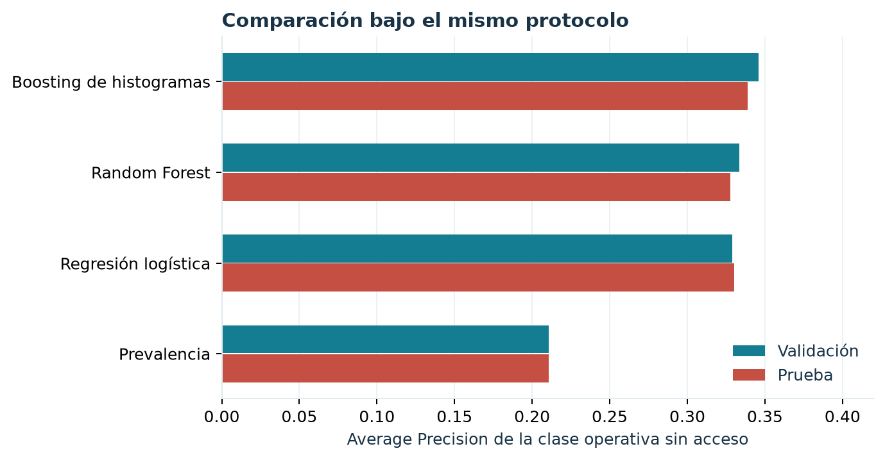
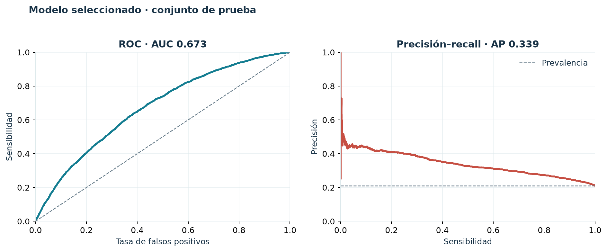
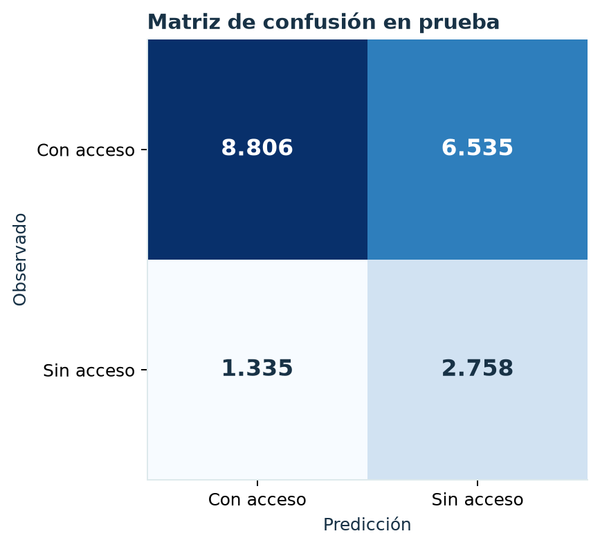
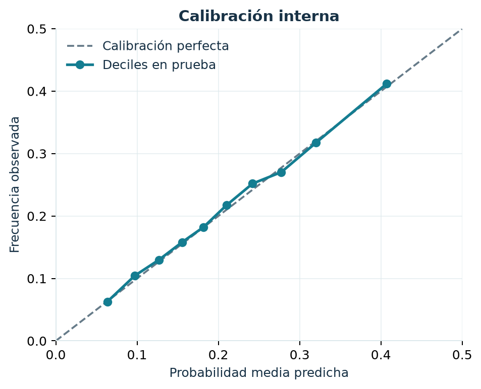
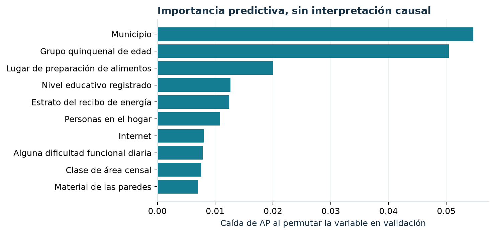
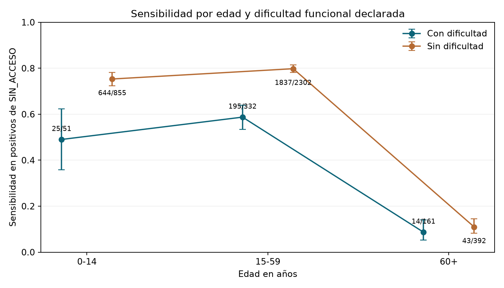

# Modelo predictivo y evaluación {#modelo}

## Pregunta predictiva y criterio de éxito

La clase positiva para evaluar el modelo es `SIN_ACCESO = 1`, que corresponde a la clase 0 de `ACCESO_FORMAL_SALUD` en el notebook. Su prevalencia en la cohorte es `r porcentaje(resumen$porcentaje_sin_formal)`. Por eso la exactitud global (*accuracy*) no sería suficiente: un clasificador que siempre dijera «con acceso» acertaría en cerca de ocho de cada diez registros y nunca encontraría un caso de interés.

La métrica principal de selección fue **Average Precision (AP)** de la clase positiva, calculada con `average_precision_score` de scikit-learn. AP resume la relación entre precisión y sensibilidad al ordenar personas por probabilidad; el campo `pr_auc` del experimento guarda este valor no interpolado, no el área trapezoidal de la curva. Se añadieron ROC-AUC, Brier, F1, precisión, sensibilidad, especificidad, matriz de confusión y calibración. El baseline asigna a todos la prevalencia aprendida en entrenamiento y ofrece un punto de comparación honesto.

## Candidatos y elección

Se compararon una regresión logística regularizada, Random Forest y boosting de histogramas. Para la logística se ensayaron distintos valores de regularización y pesos de clase. Para el bosque y el boosting se buscaron combinaciones acotadas de complejidad y tamaño mínimo de hoja. La selección se hizo con AP en validación cruzada del entrenamiento y luego se contrastó en validación. No se usó el conjunto de prueba para elegir la arquitectura.

```{r fig-modelos, fig.cap="Average Precision en validación y prueba para cada candidato. La línea base es la prevalencia de la clase positiva en cada partición."}

```

```{r tabla-modelos}
modelos <- leer("comparacion_modelos.csv")
modelos$`AP CV` <- ifelse(is.na(modelos$ap_cv), "—", vapply(modelos$ap_cv, fraccion, character(1)))
modelos$`AP validación` <- vapply(modelos$ap_validacion, fraccion, character(1))
modelos$`AP prueba` <- vapply(modelos$ap_prueba, fraccion, character(1))
modelos$`ROC-AUC` <- vapply(modelos$roc_auc_prueba, fraccion, character(1))
modelos$Brier <- vapply(modelos$brier_prueba, fraccion, character(1))
knitr::kable(modelos[, c("modelo", "AP CV", "AP validación", "AP prueba", "ROC-AUC", "Brier")],
             col.names = c("Modelo", "AP CV", "AP validación", "AP prueba", "ROC-AUC prueba", "Brier prueba"),
             caption = "Rendimiento bajo el mismo protocolo de datos y particiones.")
```

El mejor candidato en validación fue **boosting de histogramas**, con AP `r fraccion(modelos$ap_validacion[modelos$codigo == "hist_gradient_boosting"])`. En prueba obtuvo AP `r fraccion(modelos$ap_prueba[modelos$codigo == "hist_gradient_boosting"])`, ROC-AUC `r fraccion(modelos$roc_auc_prueba[modelos$codigo == "hist_gradient_boosting"])` y Brier `r fraccion(modelos$brier_prueba[modelos$codigo == "hist_gradient_boosting"])`. La mejora observada frente al baseline de AP `r fraccion(modelos$ap_prueba[modelos$codigo == "baseline"])` aparece en esta evaluación interna, pero la discriminación sigue siendo **moderada**.

La elección no se apoya en una sola cifra: el boosting mostró la mayor AP en validación y prueba, el mayor ROC-AUC y el menor Brier de los candidatos probados. Su diferencia de AP de prueba frente al bosque fue aproximadamente 0,011. Un bootstrap agrupado por vivienda de 250 repeticiones situó esa diferencia entre 0,0035 y 0,0183 en un intervalo percentil del 95 %. Es evidencia interna de ventaja en estos datos, no una garantía universal.

```{r hiperparametros}
hip <- leer("hiperparametros.csv")
knitr::kable(hip, col.names = c("Parámetro del modelo seleccionado", "Valor"),
             caption = "Configuración seleccionada del boosting de histogramas. La parada temprana interna se desactivó para no crear otra partición de datos.")
```

No se compararon XGBoost, LightGBM ni CatBoost porque no estaban disponibles en el entorno de ejecución del experimento. «Mejor modelo» significa **mejor entre los candidatos efectivamente evaluados** bajo el protocolo descrito.

## Curvas, calibración y umbral

```{r fig-curvas, fig.cap="Curvas ROC y precisión–recall recalculadas en la prueba desde el artefacto serializado. La línea discontinua de precisión–recall es la prevalencia de la clase positiva."}

```

El umbral de clasificación se escogió en validación para maximizar F1 y se fijó antes de la evaluación de prueba. Es `r fraccion(leer("umbrales_prueba.csv")$threshold[1], 4)`. Su utilidad depende del costo de los errores y de la capacidad real de seguimiento; no hay una razón para adoptarlo automáticamente en una intervención.

```{r tabla-umbrales}
u <- leer("umbrales_prueba.csv")
for (nombre in c("threshold", "f1", "precision", "recall", "specificity")) {
  u[[nombre]] <- vapply(u[[nombre]], fraccion, character(1))
}
knitr::kable(u, col.names = c("Criterio", "Umbral", "F1", "Precisión", "Sensibilidad", "Especificidad"),
             caption = "Dos umbrales aplicados al mismo modelo en la prueba interna.")
```

Con el umbral elegido, se marcaron `r entero(leer("matriz_confusion.csv")$marcados)` de `r entero(leer("particiones.csv")$n[3])` personas en prueba. La precisión fue `r fraccion(leer("comparacion_modelos.csv")$precision_prueba[4])` y la sensibilidad `r fraccion(leer("comparacion_modelos.csv")$recall_prueba[4])`: aproximadamente tres de cada diez marcadas pertenecían a la clase positiva definida por el EDA. A 0,5 la sensibilidad cae de forma pronunciada. El umbral ilustra la tensión entre cobertura y carga de revisión.

```{r fig-confusion, fig.cap="Matriz de confusión para la clase operativa sin acceso en la prueba, con el umbral elegido en validación. Filas: etiqueta observada; columnas: predicción."}

```

```{r fig-calibracion, fig.cap="Probabilidad media predicha y frecuencia observada en diez grupos de puntuación de la prueba. La diagonal indica igualdad perfecta."}

```

El error de Brier del modelo (`r fraccion(modelos$brier_prueba[4])`) es menor que el del baseline (`r fraccion(modelos$brier_prueba[1])`). En el decil con puntuaciones más altas se predijo en promedio `r porcentaje(100 * tail(leer("calibracion.csv")$mean_predicted, 1))` y se observó `r porcentaje(100 * tail(leer("calibracion.csv")$observed, 1))`. Esta calibración interna es alentadora, pero no reemplaza una revisión con datos de otro año o territorio.

## Variables relevantes y diferencias entre grupos

```{r fig-importancia, fig.cap="Diez variables con mayor caída media de AP al permutar cada predictor en validación. Mide aporte predictivo dentro del modelo, no efecto causal."}

```

Municipio y edad fueron las variables con mayor importancia por permutación, seguidas por el lugar de preparación de alimentos, nivel educativo, estrato y tamaño del hogar. La dependencia del municipio sugiere que el rendimiento puede apoyarse en patrones territoriales específicos de 2018. Se eligió importancia por permutación para resumir el comportamiento predictivo; no se calculó SHAP en esta auditoría. Ninguna de las dos técnicas, por sí sola, respondería qué ocurriría si se modificara una condición social.

```{r equidad-tabla}
eq <- leer("equidad_dificultad.csv")
eq$Personas <- vapply(eq$n, entero, character(1))
eq$Sensibilidad <- vapply(100 * eq$recall_no_access, porcentaje, character(1))
eq$Precisión <- vapply(100 * eq$precision_no_access, porcentaje, character(1))
knitr::kable(eq[, c("grupo", "Personas", "Sensibilidad", "Precisión")],
             col.names = c("Dificultad funcional", "Personas en prueba", "Sensibilidad", "Precisión"),
             caption = "Rendimiento del umbral elegido según dificultad funcional declarada, en la prueba interna.")
```

El mismo umbral recuperó una menor fracción de positivos entre las personas con dificultad funcional que entre quienes no la declararon. Esa brecha exige atención antes de cualquier uso operativo. Otros subgrupos por municipio incluyen muy pocos positivos, por lo que sus métricas no se publican aquí como rankings estables.

## Revisión adicional del modelo en 2026 {#revision-modelo-2026}

Después de la evaluación inicial, repetimos el pipeline con los CSV originales y comprobamos que las particiones, las huellas de los archivos y las predicciones del artefacto coincidieran con lo archivado. Esta revisión conservó la misma cohorte y la misma definición de la respuesta. Se probaron cambios acotados en el tratamiento de faltantes, una medida de personas por dormitorio, ajustes del boosting y una mezcla fija con regresión logística. La selección siguió basándose en Average Precision de la clase operativa `SIN_ACCESO = 1` y en validación agrupada por vivienda.

```{r tabla-auditoria-2026}
auditoria <- leer("auditoria_modelo_2026.csv")
auditoria$`AP CV` <- vapply(auditoria$ap_cv, fraccion, character(1))
auditoria$`AP validación` <- vapply(auditoria$ap_validacion, fraccion, character(1))
auditoria$`Brier validación` <- vapply(auditoria$brier_validacion, fraccion, character(1))
knitr::kable(auditoria[, c("fase", "ensayo", "AP CV", "AP validación", "Brier validación")],
             col.names = c("Ronda", "Ensayo", "AP CV", "AP validación", "Brier validación"),
             caption = "Variantes nuevas frente al boosting original. La prueba histórica no se utilizó para elegirlas.")
```

```{r resumen-auditoria-2026, include=FALSE}
revision <- leer("auditoria_resumen_2026.csv")[1, ]
```

La mayor AP numérica de la ampliación en validación fue `r fraccion(revision$ap_maxima_validacion_ampliacion, 4)`, frente a `r fraccion(revision$ap_original_validacion, 4)` del modelo original: una diferencia menor de una milésima. La mezcla fija obtuvo la mejor media de validación cruzada entre las variantes de la segunda ronda, pero su diferencia de AP en validación fue apenas `r fraccion(revision$delta_ampliacion, 4)`. El intervalo percentil del 95 % de 250 remuestreos pareados por vivienda fue [`r fraccion(revision$delta_ampliacion_inf, 4)`, `r fraccion(revision$delta_ampliacion_sup, 4)`]; incluye cero. La calibración Platt ajustada solo con predicciones fuera de pliegue del entrenamiento tampoco redujo Brier en validación. **Se conserva el modelo original.** La prueba histórica ya había sido observada en el proyecto y no se utilizó para orientar estos ensayos.

La revisión examinó también la sensibilidad del umbral por edad y dificultad funcional. En la prueba histórica, la sensibilidad fue `r porcentaje(100 * revision$recall_dificultad)` entre quienes declararon dificultad y `r porcentaje(100 * revision$recall_sin_dificultad)` entre quienes no la declararon. Tras estandarizar descriptivamente por la edad de los casos positivos en tres bandas, las cifras fueron `r porcentaje(100 * revision$recall_ajustada_dificultad)` y `r porcentaje(100 * revision$recall_ajustada_sin_dificultad)`. La edad explica parte de la diferencia, pero no la elimina. Esto no identifica una causa ni demuestra discriminación por sí solo.

```{r fig-brecha-2026, fig.cap="Sensibilidad del umbral por edad y dificultad funcional declarada. Las etiquetas junto a los puntos muestran verdaderos positivos sobre positivos observados; las barras son intervalos Wilson del 95 %."}

```

Para plantear otra pregunta de generalización, se dejaron fuera del ajuste, uno por uno, los tres municipios con más personas en entrenamiento. En cada ensayo se retiró `U_MPIO` como predictor para no usar un código territorial desconocido. Los resultados se muestran por separado porque el tamaño y la prevalencia cambian; no equivalen a la prueba habitual de nuevas viviendas dentro de municipios representados.

```{r tabla-territorio-2026}
territorio <- leer("auditoria_territorio_2026.csv")
territorio$Personas <- vapply(territorio$n, entero, character(1))
territorio$Positivos <- vapply(territorio$positivos, entero, character(1))
territorio$Prevalencia <- vapply(100 * territorio$prevalencia, porcentaje, character(1))
territorio$AP <- vapply(territorio$ap, fraccion, character(1))
territorio$`ROC-AUC` <- vapply(territorio$roc_auc, fraccion, character(1))
knitr::kable(territorio[, c("municipio", "Personas", "Positivos", "Prevalencia", "AP", "ROC-AUC")],
             col.names = c("Municipio fuera del ajuste", "Personas", "Positivos", "Prevalencia", "AP", "ROC-AUC"),
             caption = "Sensibilidad territorial exploratoria realizada dentro del entrenamiento histórico.")
```

Los intervalos de AP de esta auditoría condicionan en predicciones de modelos fijos: no incorporan toda la incertidumbre del entrenamiento y de la selección. Tampoco hay validación temporal o geográfica externa. CatBoost, LightGBM y XGBoost no pudieron ejecutarse en el entorno local porque no estaban instalados y el acceso a PyPI estaba bloqueado; no se les atribuye rendimiento.

## Alcance de la prueba

La separación por vivienda evalúa generalización a otras viviendas **de los mismos municipios y del mismo censo**. No evalúa transferencia temporal, un nuevo departamento ni un registro clínico. Esta auditoría revisó un protocolo previo de evaluación; por ello, la prueba final es una evaluación interna revisada, no una prueba externa confirmatoria que haya permanecido intacta desde el inicio del proyecto.
